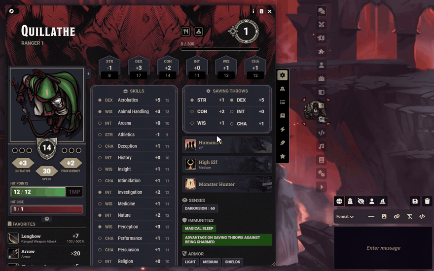

# Sephral’s Roll Breakdown

**"Wait, why is my attack +9?"** Roll Breakdown answers that right on the chat card: every die, every modifier and, in D&D 5e, the reasons for advantage and disadvantage.

*The demo uses Quillathe, one of the premade heroes of the D&D 5e system, with Bless and Archery as active effects.*

## Highlights

* **Every number explained:** a compact panel on the chat card shows the dice, the modifiers and every other part of the formula.
* **Made for D&D 5e:** attacks, damage, saves, ability, skill and tool checks, concentration and death saves, each with its real sources.
* **Why advantage?** When modules like MidiQOL record the reasons, the panel lists them, such as flanking, a prone target or long range. In D&D 5e 6 it also names the effects whose rules grant advantage or a bonus.
* **Honest by design:** the panel only shows what the roll really contains. It never guesses a source.
* **Monster bonuses stay secret:** players see no breakdown on NPC and GM rolls, unless you want them to.
* **GM rolls stay behind the screen:** if you like, players see only the total of your rolls, and your private rolls not at all.
* **Out of the way:** the panel stays folded until someone opens it, and an open panel stays open while the chat updates.
* **Made for Crucible too:** see which boons and banes changed which die, where every bonus comes from, the result against the DC and how the damage adds up.
* **More systems:** Pathfinder 2e and Savage Worlds show their named modifiers and results, every other system gets a general breakdown of dice and modifiers.

## How it works

1. Enable the module.
2. Roll as usual.
3. Click **Breakdown** on the chat card.

You decide who sees the panel: only the GM, the GM and the owner of the roll, or everyone.

## Install

Search for **Roll Breakdown** in Foundry's module browser or open the [package page](https://foundryvtt.com/packages/sephrals-roll-breakdown).

Foundry VTT 13 and 14 · any game system, extra details for D&D 5e, Crucible, Pathfinder 2e and Savage Worlds · English and German

## Help it get better

A modifier shows up as unknown? Post a screenshot of the chat card on [Discord](https://discord.gg/7BjCgDYaBP) and help teach the breakdown something new.

## Learn more

The [manual](MANUAL.md) lists every setting, explains what can be resolved and what cannot, and what a helpful bug report contains.

Looking for more? See [all modules by Sephral](https://github.com/Sephral).

## License

See [LICENSE.md](LICENSE.md).
